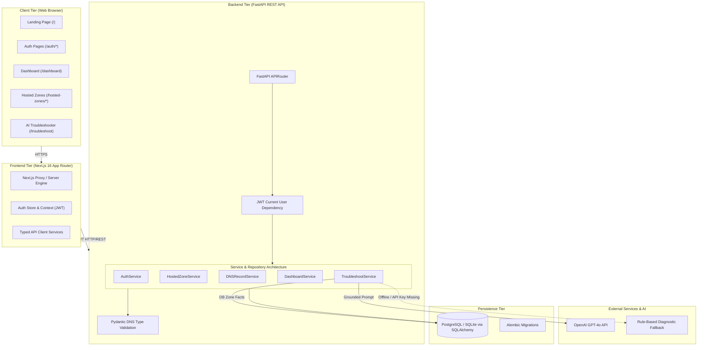
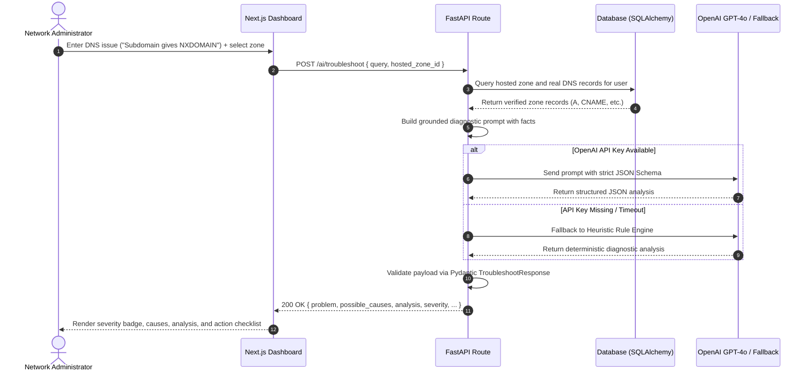
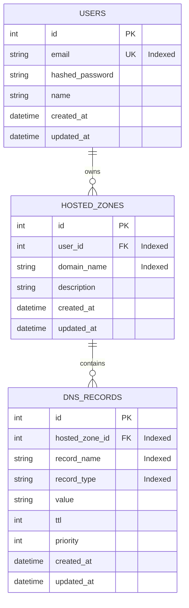
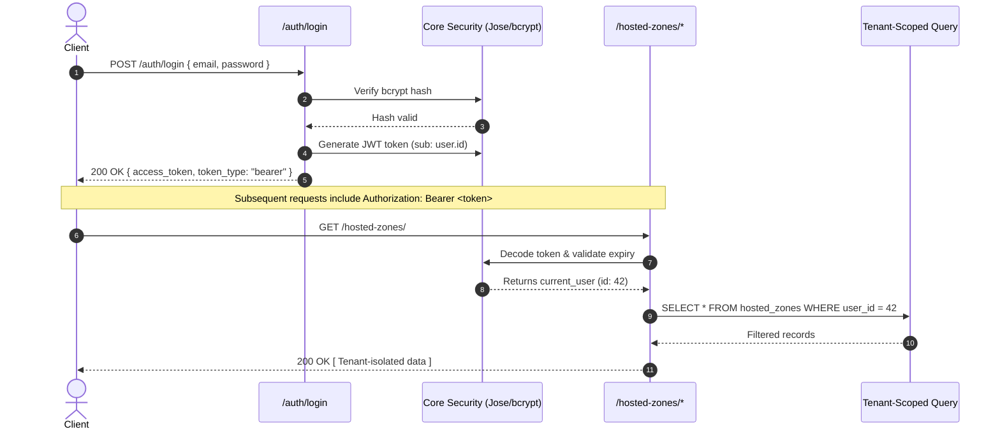

<div align="center">

# ☁️ Route53 - Cloud DNS Management & AI Troubleshooter

### A production-grade DNS management platform inspired by AWS Route 53 with an integrated AI-powered DNS Troubleshooter.

[](https://github.com/aditya2005-code/Route53/actions/workflows/ci.yml)
[](https://nextjs.org/)
[](https://react.dev/)
[](https://fastapi.tiangolo.com/)
[](https://www.postgresql.org/)
[](https://openai.com/)
[](https://www.docker.com/)
[](https://route53-beryl.vercel.app)
[](https://route53-backend-2vlc.onrender.com)

<br/>

[🌐 Live Deployment](https://route53-beryl.vercel.app) · [📖 Interactive API Docs](https://route53-backend-2vlc.onrender.com/docs) · [🐙 GitHub Repository](https://github.com/aditya2005-code/Route53)

</div>

---

## 📑 Table of Contents

- [1. Project Overview](#1-project-overview)
- [2. System Architecture](#2-system-architecture)
- [3. Key Features](#3-key-features)
- [4. Technology Stack](#4-technology-stack)
- [5. Database Schema & Indexing](#5-database-schema--indexing)
- [6. REST API Reference](#6-rest-api-reference)
- [7. Authentication & Tenant Isolation](#7-authentication--tenant-isolation)
- [8. AI-Powered DNS Troubleshooter](#8-ai-powered-dns-troubleshooter)
- [9. Repository Directory Structure](#9-repository-directory-structure)
- [10. Local Development Setup](#10-local-development-setup)
- [11. Docker & Containerized Execution](#11-docker--containerized-execution)
- [12. Database Migrations](#12-database-migrations)
- [13. Automated Testing & Verification](#13-automated-testing--verification)
- [14. Engineering Decisions & Design Principles](#14-engineering-decisions--design-principles)
- [15. Known Limitations & Roadmap](#15-known-limitations--roadmap)

---

## 1. Project Overview

**Route53** is a cloud-grade DNS management platform engineered to deliver the reliability, precision, and architectural discipline of AWS Route 53. Beyond standard CRUD management for hosted zones and domain records, the platform incorporates an intelligent **AI DNS Troubleshooter** that performs root-cause analysis on real DNS configurations to resolve propagation failures, NXDOMAIN errors, CNAME collisions, and MX/SPF mail issues.

### Core Capabilities
1. **Hosted Zone Lifecycle Management**: Complete domain zone creation, metadata administration, domain name validation, and cascaded deletion protection.
2. **Strict DNS Record Engine**: Full CRUD support for 9 DNS record types (`A`, `AAAA`, `CNAME`, `MX`, `TXT`, `NS`, `SRV`, `CAA`, `PTR`) backed by Pydantic validation (RFC compliant IPv4, IPv6, canonical hostnames, priorities, TTL bounds).
3. **Real-time Analytical Dashboard**: Live operational metrics aggregated across zones, distribution charts by record type, and recent telemetry without mock statistics.
4. **AI-Powered Diagnostics**: Grounded OpenAI GPT-4o troubleshooting anchored in user database facts with built-in heuristic fallback when offline.
5. **Defense-in-Depth Security**: Stateless JWT bearer tokens, bcrypt password hashing, tenant-isolated data access, CORS controls, and HTTP-only cookie support.

---

## 2. System Architecture



### AI Troubleshooting Workflow



---

## 3. Key Features

### 🔐 Authentication & Access Control
- Secure user registration and authentication with **bcrypt** password hashing.
- **JWT access tokens** with configurable expiration (`ACCESS_TOKEN_EXPIRE_MINUTES`).
- Centralized `get_current_user` dependency enforcing tenant isolation across all endpoints.
- Unauthenticated requests are rejected immediately with `401 Unauthorized`.
- Users cannot access, modify, or delete resources belonging to other tenants (`404 Not Found` or `403 Forbidden`).

### 🌐 Hosted Zone Management
- Create, list, retrieve, update, and delete hosted zones.
- Domain name syntax validation preventing malformed or invalid names.
- Cascading deletion: deleting a hosted zone safely purges all associated DNS records.
- Server-side search and pagination (`page`, `limit`).

### 📋 DNS Record Engine (9 Supported Types)
| Record Type | Description | RFC Validation Rules Enforced |
|---|---|---|
| **A** | IPv4 Address Mapping | Valid IPv4 address format (e.g. `192.0.2.1`). Prevents hostnames or IPv6. |
| **AAAA** | IPv6 Address Mapping | Valid 128-bit IPv6 address format (e.g. `2001:db8::1`). |
| **CNAME** | Canonical Domain Alias | Valid domain name. Must end with dot or valid FQDN. Rejects raw IP addresses. |
| **MX** | Mail Exchange Server | Valid destination host with mandatory priority integer ($0 \le P \le 65535$). |
| **TXT** | Text & Verification Metadata | Quoted or standard ASCII string up to 1024 characters. |
| **NS** | Authoritative Name Server | Valid domain name representing authoritative name servers. |
| **SRV** | Service Location Record | Formatted as `priority weight port target`. |
| **CAA** | Certificate Authority Authorization | Formatted as `flag tag "value"`. |
| **PTR** | Reverse DNS Pointer | Valid domain name target (e.g. `host.example.com.`). |

### 📊 Real-Time Analytical Dashboard
- **GET /dashboard/summary** calculates live statistics strictly from database queries:
  - Total active hosted zones for the logged-in user.
  - Total active DNS records for the logged-in user.
  - Distribution breakdown grouped by record type (`A`, `CNAME`, `MX`, etc.).
  - Recent zones list with creation timestamps.
  - Recent records list with hostnames, types, and values.

### 🤖 AI-Powered DNS Troubleshooter
- Natural language query interface with optional zone context.
- Grounded prompt engineering: automatically queries the user's database records to feed real configuration facts into the model.
- Strict Pydantic response validation:
  ```json
  {
    "problem": "Identified root issue",
    "possible_causes": ["Cause 1", "Cause 2"],
    "analysis": "In-depth technical breakdown",
    "recommended_actions": ["Action 1", "Action 2"],
    "severity": "high | medium | low",
    "requires_manual_verification": true
  }
  ```
- Graceful offline fallback: includes deterministic rule-based heuristics for common DNS issues (NXDOMAIN, CNAME apex conflicts, MX/SPF mail issues, and propagation delays).

---

## 4. Technology Stack

### Frontend Tier
- **Framework**: [Next.js 16](https://nextjs.org/) (App Router & Turbopack)
- **UI Library**: [React 19](https://react.dev/)
- **Language**: [TypeScript 5](https://www.typescriptlang.org/) (Strict mode)
- **Styling**: [Tailwind CSS 4](https://tailwindcss.com/)
- **Forms & Validation**: [React Hook Form](https://react-hook-form.com/) + [Zod 3](https://zod.dev/)
- **Icons**: [Lucide React](https://lucide.dev/)
- **HTTP Client**: [Axios](https://axios-http.com/) with bearer token interceptors

### Backend Tier
- **Framework**: [FastAPI 0.115](https://fastapi.tiangolo.com/)
- **ASGI Server**: [Uvicorn](https://www.uvicorn.org/)
- **Language**: Python 3.11+
- **ORM**: [SQLAlchemy 2.0](https://www.sqlalchemy.org/)
- **Validation**: [Pydantic 2.x](https://docs.pydantic.dev/)
- **Security**: [python-jose](https://github.com/mpdavis/python-jose) (JWT) + [passlib/bcrypt](https://passlib.readthedocs.io/)
- **Database Migrations**: [Alembic](https://alembic.sqlalchemy.org/)
- **HTTP Client**: [HTTPX](https://www.python-httpx.org/)

### Persistence & Infrastructure
- **Relational Databases**: PostgreSQL 15 (Production & Docker) / SQLite 3 (Local testing)
- **Containerization**: Docker & Docker Compose
- **Continuous Integration**: GitHub Actions CI (`.github/workflows/ci.yml`)

---

## 5. Database Schema & Indexing



### Optimization & Indexing Strategy
- `users(email)`: Unique B-tree index for $O(1)$ authentication lookups.
- `hosted_zones(user_id)`: Composite index to rapidly filter zones per tenant.
- `hosted_zones(domain_name)`: Index for domain searches and uniqueness verification.
- `dns_records(hosted_zone_id)`: Foreign key index ensuring fast zone record retrieval and cascade execution.
- `dns_records(record_name, record_type)`: High-performance composite filtering for DNS lookups and troubleshooting queries.

---

## 6. REST API Reference

Interactive OpenAPI documentation is accessible at `/docs` (Swagger UI) and `/redoc` (ReDoc).

### Authentication Endpoints
| Method | Endpoint | Description | Auth Required |
|---|---|---|:---:|
| `POST` | `/auth/register` | Register a new user account | No |
| `POST` | `/auth/login` | Authenticate user and return JWT bearer token | No |
| `GET` | `/auth/me` | Fetch authenticated user profile | **Yes** |
| `POST` | `/auth/logout` | Client token invalidation acknowledgment | **Yes** |

### Hosted Zones Endpoints
| Method | Endpoint | Description | Auth Required |
|---|---|---|:---:|
| `POST` | `/hosted-zones/` | Create a new hosted zone | **Yes** |
| `GET` | `/hosted-zones/` | List hosted zones (supports `search`, `page`, `limit`) | **Yes** |
| `GET` | `/hosted-zones/{zone_id}` | Retrieve details of a specific hosted zone | **Yes** |
| `PUT` | `/hosted-zones/{zone_id}` | Update domain description or metadata | **Yes** |
| `DELETE` | `/hosted-zones/{zone_id}` | Delete hosted zone and cascade delete records | **Yes** |

### DNS Records Endpoints
| Method | Endpoint | Description | Auth Required |
|---|---|---|:---:|
| `POST` | `/hosted-zones/{zone_id}/records` | Create a new DNS record in zone | **Yes** |
| `GET` | `/hosted-zones/{zone_id}/records` | List records (supports `type`, `search`, `page`, `limit`) | **Yes** |
| `GET` | `/hosted-zones/{zone_id}/records/{id}` | Retrieve individual DNS record | **Yes** |
| `PUT` | `/hosted-zones/{zone_id}/records/{id}` | Update DNS record value, TTL, or priority | **Yes** |
| `DELETE` | `/hosted-zones/{zone_id}/records/{id}` | Delete DNS record | **Yes** |

### Dashboard & Analytics Endpoints
| Method | Endpoint | Description | Auth Required |
|---|---|---|:---:|
| `GET` | `/dashboard/summary` | Retrieve live zone counts, record counts, type breakdown | **Yes** |

### AI Troubleshooter Endpoints
| Method | Endpoint | Description | Auth Required |
|---|---|---|:---:|
| `POST` | `/ai/troubleshoot` | Submit DNS question for grounded AI analysis | **Yes** |
| `POST` | `/troubleshoot` | Alias for AI troubleshooter endpoint | **Yes** |

---

## 7. Authentication & Tenant Isolation



---

## 8. AI-Powered DNS Troubleshooter

### Architecture & Grounded Prompting
Unlike generic chatbot wrappers, Route53 anchors AI recommendations in verified facts:
1. The user provides a troubleshooting inquiry and selects an affected zone.
2. The backend retrieves the zone's active DNS records from the database.
3. The records are serialized into a factual JSON context block inside the system prompt:
   ```
   System: You are an expert DNS engineer.
   Zone: example.com
   Database Verified Records:
     - Record: www.example.com | Type: CNAME | Value: cdn.example.net | TTL: 300
     - Record: example.com | Type: A | Value: 198.51.100.1 | TTL: 3600
   ```
4. OpenAI evaluates the configuration against standard DNS RFC rules and returns structured diagnosis.
5. In the event of network disruption or missing API keys, the deterministic fallback engine handles common diagnostic patterns seamlessly.

---

## 9. Repository Directory Structure

```
Route53/
├── .github/
│   └── workflows/
│       └── ci.yml                     # Continuous Integration workflow
├── backend/
│   ├── alembic/                       # Alembic database migrations
│   │   ├── env.py
│   │   └── versions/
│   ├── app/
│   │   ├── api/                       # API layer
│   │   │   ├── api.py                 # APIRouter index
│   │   │   ├── dependencies.py        # Authentication dependencies
│   │   │   └── routes/                # Endpoint handlers (auth, zones, dns, etc.)
│   │   ├── core/                      # Core configuration & security
│   │   │   ├── config.py              # Environment settings
│   │   │   ├── exceptions.py          # Centralized error handling
│   │   │   └── security.py            # Password hashing & JWT issuance
│   │   ├── db/                        # Database engine and base models
│   │   ├── models/                    # SQLAlchemy ORM models
│   │   ├── repositories/              # Database persistence layer
│   │   ├── schemas/                   # Pydantic validation models
│   │   └── services/                  # Business logic services
│   ├── tests/                         # Pytest test suite (38 tests)
│   ├── Dockerfile                     # Production backend Dockerfile
│   ├── requirements.txt               # Backend dependencies
│   └── .env.example                   # Backend environment template
├── frontend/
│   ├── app/                           # Next.js 16 App Router
│   │   ├── auth/                      # Authentication routes (login, register)
│   │   ├── dashboard/                 # Real-time metrics dashboard
│   │   ├── hosted-zones/              # Hosted zone & record management
│   │   ├── troubleshoot/              # AI Troubleshooter UI
│   │   ├── layout.tsx                 # Root layout
│   │   └── page.tsx                   # Professional landing page
│   ├── components/                    # Reusable UI & layout components
│   ├── services/                      # Axios API service clients
│   ├── types/                         # TypeScript interfaces
│   ├── utils/                         # Token & helper utilities
│   ├── proxy.ts                       # Next.js 16 server proxy
│   ├── Dockerfile                     # Multi-stage production Dockerfile
│   └── package.json                   # Dependencies & build scripts
├── docker-compose.yml                 # Multi-container orchestration
├── .env.example                       # Root environment configuration
└── README.md                          # Platform documentation
```

---

## 10. Local Development Setup

### Prerequisites
- Python 3.11+
- Node.js 20+
- PostgreSQL (or local SQLite)

### 1. Backend Setup
```bash
# Navigate to backend directory
cd backend

# Create virtual environment
python -m venv venv

# Activate virtual environment
# Windows:
.\venv\Scripts\Activate.ps1
# Linux/macOS:
source venv/bin/activate

# Install dependencies
pip install -r requirements.txt

# Configure environment variables
cp .env.example .env

# Run database migrations (or let FastAPI auto-create tables on startup)
alembic upgrade head

# Start backend server
uvicorn app.main:app --reload --host 0.0.0.0 --port 8000
```
Backend API will be live at `http://localhost:8000`  
Interactive Swagger docs: `http://localhost:8000/docs`

### 2. Frontend Setup
```bash
# Open a new terminal in frontend directory
cd frontend

# Install dependencies
npm ci

# Configure environment variables
cp .env.example .env.local

# Start development server
npm run dev
```
Frontend application will be accessible at `http://localhost:3000`

---

## 11. Docker & Containerized Execution

To spin up the entire production-ready environment with **PostgreSQL**, **FastAPI Backend**, and **Next.js Frontend**:

```bash
# Clone the repository
git clone https://github.com/aditya2005-code/Route53.git
cd Route53

# Copy root environment variables
cp .env.example .env

# Build and start all services in detached mode
docker compose up -d --build
```

### Verify Container Status
```bash
docker compose ps
```

| Container | Internal Port | Host Port | Health Check |
|---|---|---|---|
| `route53-postgres` | `5432` | `5432` | `pg_isready -U route53` |
| `route53-backend` | `8000` | `8000` | `GET /health` |
| `route53-frontend` | `3000` | `3000` | `GET /` |

To stop containers:
```bash
docker compose down
```

---

## 12. Database Migrations

Alembic is configured to track database migrations.

```bash
cd backend

# Generate a new migration after model changes
alembic revision --autogenerate -m "Add new indexes and records"

# Apply pending migrations
alembic upgrade head

# Revert previous migration
alembic downgrade -1
```

---

## 13. Automated Testing & Verification

### Backend Pytest Suite
The backend contains 38 comprehensive unit and integration tests covering Authentication, Hosted Zone CRUD, DNS Type Validation (A, AAAA, CNAME, MX, TXT, SRV, CAA, PTR), Dashboard Analytics, and AI Troubleshooting.

```bash
cd backend
python -m pytest -v
```

**Results**:
```
tests/test_auth.py::test_user_registration_success PASSED
tests/test_auth.py::test_user_registration_duplicate_email PASSED
tests/test_auth.py::test_user_login_success PASSED
tests/test_auth.py::test_user_login_invalid_password PASSED
tests/test_auth.py::test_get_current_user_profile PASSED
tests/test_dashboard.py::test_dashboard_summary_empty PASSED
tests/test_dashboard.py::test_dashboard_summary_with_records PASSED
tests/test_dashboard.py::test_dashboard_tenant_isolation PASSED
tests/test_dns_validation.py::test_valid_a_record PASSED
tests/test_dns_validation.py::test_invalid_a_record_format PASSED
tests/test_dns_validation.py::test_valid_aaaa_record PASSED
tests/test_dns_validation.py::test_invalid_aaaa_record PASSED
tests/test_dns_validation.py::test_valid_cname_record PASSED
tests/test_dns_validation.py::test_cname_cannot_be_ip_address PASSED
tests/test_dns_validation.py::test_valid_mx_record PASSED
tests/test_dns_validation.py::test_mx_record_requires_priority PASSED
tests/test_dns_validation.py::test_valid_txt_record PASSED
tests/test_dns_validation.py::test_valid_srv_record PASSED
tests/test_dns_validation.py::test_valid_caa_record PASSED
tests/test_dns_validation.py::test_valid_ptr_record PASSED
tests/test_dns_validation.py::test_invalid_ttl_out_of_bounds PASSED
tests/test_ai_troubleshooter.py::test_troubleshoot_unauthenticated PASSED
tests/test_ai_troubleshooter.py::test_troubleshoot_fallback_nxdomain PASSED
tests/test_ai_troubleshooter.py::test_troubleshoot_fallback_cname PASSED
tests/test_ai_troubleshooter.py::test_troubleshoot_fallback_mx PASSED
tests/test_ai_troubleshooter.py::test_troubleshoot_fallback_propagation PASSED
tests/test_ai_troubleshooter.py::test_troubleshoot_mocked_openai_success PASSED
...
============================= 38 passed in 1.45s =============================
```

### Frontend Verification Suite
Frontend linting, TypeScript checking, unit testing, and production builds:

```bash
cd frontend

# Run ESLint (0 errors)
npm run lint

# Run Unit Tests (12/12 passing)
npm test

# Run Production Build
npm run build
```

---

## 14. Engineering Decisions & Design Principles

1. **Separation of Concerns**: Strict architectural boundaries (`Router` → `Service` → `Repository` → `Model`). No raw SQL queries or database session logic exist inside router handlers.
2. **RFC-Compliant DNS Validation**: Type-specific validation is performed at the boundary with Pydantic and regex matchers. For example, CNAME records are verified to reject IP addresses, and MX records require strict integer priorities.
3. **Grounded AI Diagnostics**: Rather than operating as an ungrounded hallucination risk, the AI Troubleshooter injects verified domain records into the context window and mandates explicit `requires_manual_verification: true`.
4. **Deterministic Heuristic Fallback**: Network interruptions or missing API keys do not break user workflows; intelligent heuristic routines diagnose common DNS failures deterministically.
5. **Zero-Trust Multi-Tenancy**: All queries for zones, records, dashboards, and troubleshooting are filtered against `user_id` extracted from cryptographically verified JWT bearer tokens.

---

## 15. Known Limitations & Roadmap

| Feature | Description | Status |
|---|---|:---:|
| **DNS Record Validation** | Strict RFC parsing for all 9 record types | ✅ Complete |
| **Real Dashboard API** | Live query counts and type distributions | ✅ Complete |
| **AI Troubleshooter** | Grounded OpenAI analysis + offline fallback | ✅ Complete |
| **Containerization** | Multi-service Docker Compose + Postgres | ✅ Complete |
| **CI/CD Pipeline** | GitHub Actions for testing & builds | ✅ Complete |
| **BIND Zone File Import/Export** | Bulk import/export RFC 1035 zone files | 🟡 Planned |
| **Secondary DNS Sync** | AXFR / IXFR zone transfer protocol support | 🟡 Planned |
| **DNSSEC Signing** | Cryptographic zone signing with DS / DNSKEY | 🟡 Planned |

---

## 👤 Author

**Aditya Pratap Singh**  
- GitHub: [@aditya2005-code](https://github.com/aditya2005-code)  
- Repository: [https://github.com/aditya2005-code/Route53](https://github.com/aditya2005-code/Route53)  
- Live Deployment: [https://route53-beryl.vercel.app](https://route53-beryl.vercel.app)

---

## 📄 License

This project is licensed under the **MIT License** — see the [LICENSE](LICENSE) file for details.
